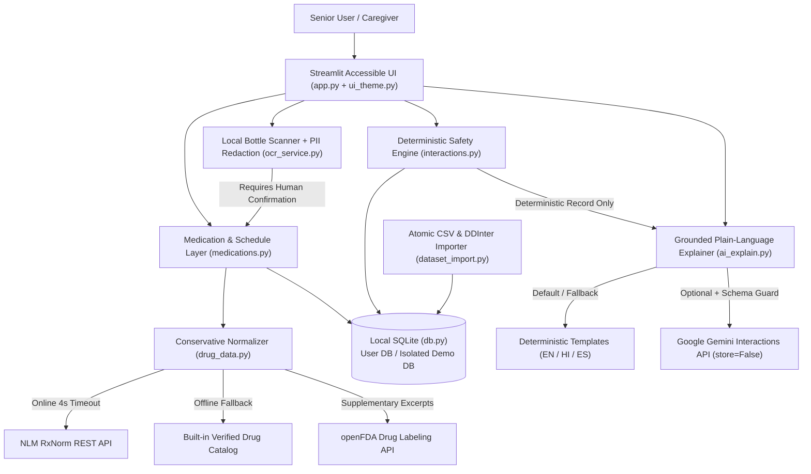

# MedSafe — Medication Safety & Daily Routine Companion

**Congressional App Challenge Submission**  
*A local-first, accessible, safety-conscious medication organization and interaction review companion designed primarily for senior adults and their caregivers.*

---

## 1. Project Overview & Congressional App Challenge Summary

**MedSafe** helps older adults, family caregivers, and patients managing multiple prescriptions, over-the-counter (OTC) medicines, and supplements maintain a clear medication list, check for documented drug–drug and food/beverage interactions, understand warnings in plain language (in English, Hindi, or Spanish), track daily doses, and prepare clean summary sheets for their pharmacist or prescriber.

Unlike generic health chatbots that ask an LLM whether two medicines are safe together, **MedSafe strictly separates deterministic database verification from AI explanation**:

- **The loaded SQLite interaction dataset — never the AI — is the sole authority** on whether a matching interaction record exists.
- **Absence of a record is never presented as proof of safety.** MedSafe explicitly distinguishes between `MATCH_FOUND`, `NO_MATCHING_RECORD`, `IDENTITY_REQUIRES_CONFIRMATION`, `UNABLE_TO_CHECK`, and `DATASET_UNAVAILABLE`.
- **Every medication identity is verified conservatively.** Fuzzy matches, brand names, combination products (such as Norco or Percocet), and scanned bottle labels always require explicit human confirmation before being treated as verified.
- **100% offline-capable & API-key-free by default.** MedSafe works completely without an internet connection, without a Gemini API key, and without Tesseract OCR installed.

---

## 2. Problem Statement & Target Audience

More than **40% of older adults in the United States** take five or more prescription medications regularly (Lown Institute, *Medication Overload*, 2019), alongside OTC pain relievers, cold medicines, and dietary supplements. Managing complex regimens creates three major challenges:

1. **Hidden Ingredient Overlap & Interactions:** Brand-name or combination products (e.g., taking an OTC NSAID like Advil while prescribed Lisinopril and Warfarin, or taking Tylenol alongside a hydrocodone/acetaminophen combination) can introduce serious bleeding, kidney, or duplicate-ingredient risks.
2. **Dense Clinical Jargon & Language Barriers:** Official package inserts are printed in tiny fonts and dense pharmacological language, creating barriers for seniors and non-English speakers.
3. **Fragmented Records at Appointments:** Seniors and caregivers often arrive at pharmacy consultations or clinic visits without an up-to-date, structured list of their active medicines, strengths, and schedules.

**Primary Audience:** Senior adults managing multiple prescriptions, OTC medicines, and supplements.  
**Secondary Audience:** Family members and caregivers, pharmacists/clinicians reviewing patient medication lists, and individuals who prefer plain-language explanations in English, Hindi (`हिन्दी`), or Spanish (`Español`).

---

## 3. Key Features

- **7-Screen Accessible Interface:**
  1. **Overview:** Immediate summary metrics, one-click *Try Guided Demo Profile* mode, quick OTC/supplement pre-check, today's next scheduled doses, and a transparent *How MedSafe Works & Safety Rules* walkthrough.
  2. **My Medicines:** Conservative RxNorm + offline reference catalog lookup, explicit candidate disambiguation, multi-ingredient combination expansion, duplicate name/ingredient warnings, edit/pause/remove controls, and supplementary openFDA official labeling excerpts.
  3. **Scan a Bottle:** Local Tesseract OCR with Pillow contrast/grayscale preprocessing, automatic regex redaction of phone/Rx/address patterns, 3 built-in synthetic demo prescription labels (`DEMO SAMPLE LABEL — NOT FOR CLINICAL USE`), and a mandatory side-by-side human confirmation step before saving.
  4. **Safety Checker:** Full pairwise drug–drug interaction check, duplicate active-ingredient detection, food/alcohol/grapefruit/dairy/potassium precautions, source metadata & attribution, and grounded plain-language explanations with side-by-side clinical record comparison.
  5. **Daily Schedule:** Grouped Morning / Midday / Evening / Bedtime routine cards, one-tap **Taken**, **Skipped**, and **Undo** logging, local missed-dose status indicators, and standard `.ics` iCalendar export.
  6. **Caregiver & Reports:** Printable HTML summary report, Markdown report, CSV medication export, auto-generated **Questions for My Pharmacist** checklist, and recent safety-check audit history.
  7. **Settings & Privacy:** Font size (`Standard 18px`, `Large 20px`, `Extra Large 22px`), high-contrast mode, language selector (`English`, `हिन्दी`, `Español`), live service/dataset diagnostics, DDInter CSV importer, and local data reset controls.

---

## 4. Safety Architecture & Limitations

MedSafe enforces six non-negotiable engineering guardrails:

1. **Deterministic Database Authority (`interactions.py`):** All pairwise drug–drug and food checks are executed via normalized SQLite queries against `drug_interactions` and `food_interactions`. AI is never queried to decide whether an interaction exists.
2. **Five Distinct Check Outcomes (`CheckStatus`):**
   - `MATCH_FOUND`: A matching interaction record exists in the loaded dataset. Displays recorded severity (`major`, `moderate`, `minor`, `unspecified`), mechanism, management note, and source citation.
   - `NO_MATCHING_RECORD`: Both medicines were confirmed and checked, and no matching record was found in the loaded dataset. **Never displayed as "Safe"** — always accompanied by dataset scope and coverage warnings.
   - `IDENTITY_REQUIRES_CONFIRMATION`: One or more medicines have unconfirmed identities (`needs_review`), so pairwise checking is withheld until confirmed.
   - `UNABLE_TO_CHECK`: A medication name could not be resolved to a known ingredient (`unidentified`).
   - `DATASET_UNAVAILABLE`: The SQLite reference dataset is missing, empty, or failed validation.
3. **Conservative Drug Normalization (`drug_data.py`):** Fuzzy edit-distance matches, brand names, multi-ingredient combinations, and OCR extractions always set `requires_confirmation = True`. Combination products expand into all constituent active ingredients (`Ingredient(name, rxcui)`) so every ingredient is checked pairwise and for duplicate overlap.
4. **Mandatory OCR Human Review (`ocr_service.py`):** Bottle images are never auto-saved. Extracted fields populate an editable verification form with explicit uncertainty notes.
5. **Schema-Validated AI Explanations (`ai_explain.py`):** When `GEMINI_API_KEY` is configured, MedSafe sends only the deterministic database record to Gemini (`v1beta/interactions`, `store=False`) and validates the JSON response (`validate_ai_payload`). Any response that omits the source severity, claims safety, uses prescriptive language (*"stop taking"*, *"change your dose"*), or injects HTML is rejected in favor of deterministic templates.
6. **Unknown Severity Preservation (`dataset_import.py`):** Records with `Unknown` or missing severity in external CSVs (such as DDInter 2.0) are mapped to `unspecified` — never silently downgraded to `minor`.

---

## 5. Architecture Diagram



---

## 6. Tech Stack

- **Language:** Python 3.10 or newer (the code uses modern type-hint syntax that does not run on 3.9; on a Mac whose system Python is 3.9, install Python 3.12 from python.org or Homebrew and run commands with `python3.12`)
- **User Interface:** Streamlit (`app.py`, `ui_theme.py`) with custom accessible CSS design tokens
- **Database:** SQLite3 (`db.py`) with versioned migrations (`SCHEMA_VERSION = 2`) and foreign-key enforcement
- **Drug Normalization & Labeling:** NLM RxNorm REST API + openFDA Drug Labeling API (`drug_data.py`) via `requests`
- **Optical Character Recognition:** Pillow (`PIL`) + `pytesseract` (`ocr_service.py`)
- **Optional AI Explanation & Translation:** Google Gemini `v1beta/interactions` REST API (`ai_explain.py`)
- **Automated Testing:** `pytest` + `streamlit.testing.v1.AppTest` (83 automated unit and integration tests across 7 modules)

---

## 7. Local Setup Instructions (Windows, macOS, Linux)

### Prerequisites
- Python 3.10 or newer

### Step 1: Clone or Open the Workspace
```bash
cd MedSafe
```

### Step 2: Create and Activate a Virtual Environment (Recommended)

**Windows (PowerShell):**
```powershell
py -m venv .venv
.\.venv\Scripts\Activate.ps1
```

**macOS / Linux:**
```bash
python3 -m venv .venv
source .venv/bin/activate
```

### Step 3: Install Python Dependencies
```bash
pip install -r requirements.txt
```

---

## 8. Running the Streamlit Application

**Windows:**
```powershell
py -m streamlit run app.py
```

**macOS / Linux:**
```bash
python3 -m streamlit run app.py
```

> macOS note: if `python3 --version` shows 3.9 (the Xcode default), use `python3.12 -m venv .venv` when creating the virtual environment, or run directly with `python3.12 -m streamlit run app.py`.

The app will open in your browser at `http://localhost:8501`.

### Using MedSafe from a tablet or phone (same Wi-Fi)

Seniors are far more comfortable on a tablet than a laptop. Start the app so other
devices on your home network can reach it:

```bash
python3 -m streamlit run app.py --server.address 0.0.0.0 --server.port 8501 --server.headless true
```

Streamlit prints a **Network URL** such as `http://192.168.1.25:8501` — open that
address in the tablet's or phone's browser. Notes: both devices must be on the same
Wi-Fi; macOS may ask once to allow incoming connections for Python (click Allow);
the app is only reachable on your home network, never from the internet; and the
camera in Scan a Bottle will use the tablet's camera (most browsers require you to
tap Allow for camera access).
- Click **Try Guided Demo Profile** in the top banner or sidebar to explore the pre-loaded senior polypharmacy scenario (`Lisinopril 10 mg`, `Warfarin 5 mg`, `Ibuprofen 200 mg`, `Metformin 500 mg`, `Potassium Chloride 20 mEq`, and `Calcium + Vitamin D3`) without affecting your personal medication list.

---

## 9. Optional Gemini API Key Setup

MedSafe works completely without an API key using deterministic plain-language templates in English, Hindi, and Spanish.

To enable optional AI-assisted plain-language explanations:
1. Copy `.env.example` to `.env`:
   ```bash
   cp .env.example .env
   ```
2. Set your key in `.env` or as an environment variable:
   ```env
   GEMINI_API_KEY=your_gemini_api_key_here
   GEMINI_MODEL=gemini-3.8-flash
   ```
3. With a key configured, the Safety Checker uses the Gemini AI assistant automatically for plain-language explanations (each result shows its explanation source). Without a key — or whenever an AI response fails validation — it falls back to the deterministic templates.

---

## 10. Optional Tesseract OCR Installation

MedSafe auto-detects Tesseract via `TESSERACT_CMD`, `PATH`, and common installation directories:

- **Windows:** Install via Winget (`winget install UB-Mannheim.TesseractOCR`) or download the installer from [UB-Mannheim Tesseract](https://github.com/UB-Mannheim/tesseract/wiki). Default path `C:\Program Files\Tesseract-OCR\tesseract.exe` is detected automatically.
- **macOS:** `brew install tesseract`
- **Ubuntu / Debian Linux:** `sudo apt-get update && sudo apt-get install -y tesseract-ocr`

---

## 11. How MedSafe Works Without Gemini or Tesseract

- **Without `GEMINI_API_KEY`:** `ai_explain.py` uses deterministic, medically cautious templates (`explain_structured` / `explain_food_structured`) with full English, Hindi, and Spanish support.
- **Without Tesseract OCR:** The **Scan a Bottle** page allows users to load the 3 built-in synthetic demo labels (`Lisinopril`, `Ibuprofen`, `Metformin`), paste or edit label text manually, and complete the full verification workflow.
- **Without Internet Connectivity:** `drug_data.py` falls back cleanly to its curated local reference catalog (`_LOCAL_CATALOG`) covering common senior prescriptions, OTC medicines, supplements, brand names, and combination opioids/analgesics.

---

## 12. How RxNorm and openFDA Are Used

- **NLM RxNorm REST API (`drug_data.py`):** Used to resolve entered medication names to standardized RxCUIs, generic ingredient names, brand synonyms, and multi-ingredient compositions (`/REST/rxcui.json`, `/REST/approximateTerm.json`, `/REST/rxcui/{id}/allrelated.json`). Approximate/fuzzy matches are never auto-accepted; they return candidate cards requiring user confirmation.
- **openFDA Drug Labeling API (`drug_data.py`):** Used in the **My Medicines** tab to display official FDA SPL package insert excerpts (`warnings`, `drug_interactions`, `dosage_and_administration`, and `effective_time`) as supplementary reference context. openFDA text is never used to override the deterministic pairwise interaction engine.

---

## 13. How the Interaction Dataset Works

On startup, `dataset_import.ensure_seed_datasets()` verifies that the SQLite database contains the starter reference datasets and imports them idempotently if needed:
- `interactions_seed.csv`: 34 documented drug–drug interaction pairs covering major cardiovascular, anticoagulant, NSAID, diabetes, thyroid, statin, CNS/opioid, and supplement interactions with severity, clinical effect, mechanism, management notes, and source record IDs.
- `food_interactions_seed.csv`: 13 food, beverage, alcohol, grapefruit, dairy, calcium/iron, and high-potassium dietary precautions.
- `aliases_seed.csv`: 55 brand, generic, and abbreviation synonyms mapped to canonical ingredient names.

---

## 14. Importing Additional DDInter 2.0 or Custom CSV Data

You can expand the local SQLite interaction database with downloaded [DDInter 2.0](https://ddinter2.scbdd.com/download/) CSV files (`ddinter_downloads_code_*.csv`) either from the **Settings & Privacy** tab in the UI or via the command-line tool:

```bash
py tools/convert_ddinter.py path/to/ddinter_csv_folder --version 2.0
```

- All imports run inside an atomic SQLite transaction (`dataset_import.py`).
- Invalid rows are logged and rejected without corrupting existing records.
- `Unknown` severity rows in DDInter are preserved as `unspecified` (never downgraded to `minor`).

---

## 15. Data Attribution & Licensing Notes

- **Starter Curated Dataset:** Educational starter seed (`interactions_seed.csv`, `food_interactions_seed.csv`, `aliases_seed.csv`) informed by public FDA product labeling and DDInter 2.0 taxonomy.
- **DDInter 2.0:** Xiong G, et al. *DDInter 2.0: an enhanced drug interaction resource with expanded data coverage, new interaction types, and improved user interface.* Nucleic Acids Research (2024). Available under **Creative Commons Attribution-NonCommercial 4.0 International (CC BY-NC 4.0)** for non-commercial educational and research use.
- **RxNorm:** Courtesy of the U.S. National Library of Medicine (NLM), National Institutes of Health, Department of Health and Human Services. NLM is not responsible for the product and does not endorse or recommend this or any other product.
- **openFDA:** Public domain data courtesy of the U.S. Food and Drug Administration. Do not rely on openFDA alone to make decisions regarding medical care.

---

## 16. Running Automated Tests

Run the full test suite (83 tests across 7 test modules) with `pytest`:

```bash
py -m pytest -v
```

Test modules:
- `tests/test_interactions.py`: Forward/reverse pair lookup, synonym resolution, combination product ingredient expansion, duplicate ingredient warnings, `NO_MATCHING_RECORD` safety language, `DATASET_UNAVAILABLE` handling, and atomic import rollback.
- `tests/test_drug_matching.py`: Exact generic matching, brand/combination confirmation guardrails, fuzzy match non-auto-confirmation, offline fallback, and openFDA parsing.
- `tests/test_ocr.py`: Synthetic sample bottle generation & parsing, garbled/empty OCR text handling, missing strength safety, unavailable Tesseract fallback, and human confirmation state transition.
- `tests/test_ai_explain.py`: Offline template generation, API failure fallback, strict schema validation rejecting hallucinated safety claims or prescriptive dose advice, and multilingual (`English`, `हिन्दी`, `Español`) output preservation.
- `tests/test_database.py`: Medication CRUD, soft deactivation, schedule & dose logging, `.ics`/CSV/Markdown/HTML exports, `clear_user_data` preserving reference datasets, and non-destructive legacy v1 `meds` migration.
- `tests/test_app_logic.py`: End-to-end Congressional App Challenge demo flow, translation completeness across all 3 languages, DDInter folder import, and headless Streamlit `AppTest` verification across all 7 UI sections.

---

## 17. Privacy Notes

- **Local-First SQLite Storage:** Personal medication lists, schedules, and dose logs are stored locally on your device in `data/medsafe.sqlite3` (and `data/medsafe_demo.sqlite3` for the isolated demo profile).
- **No Unsolicited Outbound Transmission:** Automatic caregiver email alerts have been intentionally removed so medication data never leaves your computer unexpectedly.
- **PII Redaction Before Display:** `ocr_service.redact_label_pii()` masks phone numbers, Rx numbers, and street address patterns on scanned bottle text.
- **Zero AI Retention Flag:** Optional Gemini API calls pass `"store": False` and send only the normalized drug names and deterministic database record — never raw bottle photos, patient names, or full medication schedules.

---

## 18. Known Limitations & Future Improvements

- **Starter Dataset Coverage:** The bundled starter dataset contains 34 drug–drug pairs and 13 food precautions for demonstration and educational use. It is not a comprehensive clinical compendium.
- **Pairwise Scope:** The deterministic engine checks drug–drug pairs, active-ingredient duplicates, and food precautions, but does not evaluate patient-specific kidney/liver function (eGFR/Child-Pugh), age/weight dosing, allergies, or three-way pharmacodynamic interactions.
- **Future Enhancements:** Optional RxImage pill visual verification, FHIR `MedicationStatement` export for patient portals, and localized voice read-aloud (Web Speech API) for low-vision accessibility.

---

## 19. Medical Disclaimer

> **IMPORTANT MEDICAL DISCLAIMER:**  
> MedSafe is an educational medication organization prototype created for the Congressional App Challenge. It is **not** a medical device, clinical decision support system, or substitute for professional medical judgment. Absence of an interaction alert in MedSafe **never** means two medications are safe to take together. Always consult a licensed pharmacist or physician before starting, stopping, or changing any medication, dose, or schedule. In a medical emergency, call **911** or Poison Control at **1-800-222-1222** immediately.

